# Lab 3: District Dashboard — Layers, Controls and Interaction

**Course:** WebGIS  
**Student:** Muhammad Ahmad  
**Roll number:** 538160  

**Interactive web map:** [https://megaorbits.github.io/webgis-lab3/index.html](https://megaorbits.github.io/webgis-lab3/index.html)

**GitHub repository:** [https://github.com/megaorbits/webgis-lab3](https://github.com/megaorbits/webgis-lab3)

To run locally, serve the folder (`python -m http.server 8080`) so `data/districts.geojson` and `data/district_points.geojson` load. Canvas mode is `index.html?canvas`.

---

## Checkpoint 1: Set Up the Project

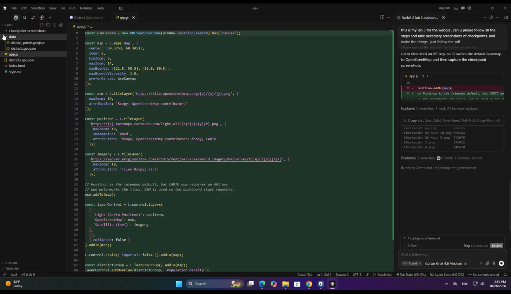

The Lab 3 folder contains `index.html`, `style.css`, and `app.js`, with district GeoJSON in `data/`. Leaflet **1.9.4** is loaded from unpkg.

<table>
  <thead>
    <tr><th>Item</th><th>Value</th></tr>
  </thead>
  <tbody>
    <tr><td>Entry page</td><td><code>index.html</code></td></tr>
    <tr><td>Styles</td><td><code>style.css</code></td></tr>
    <tr><td>Map logic</td><td><code>app.js</code></td></tr>
    <tr><td>Polygons</td><td><code>data/districts.geojson</code> (160 features)</td></tr>
    <tr><td>Library</td><td>Leaflet 1.9.4</td></tr>
  </tbody>
</table>

---

## Checkpoint 2: Make a Point Layer

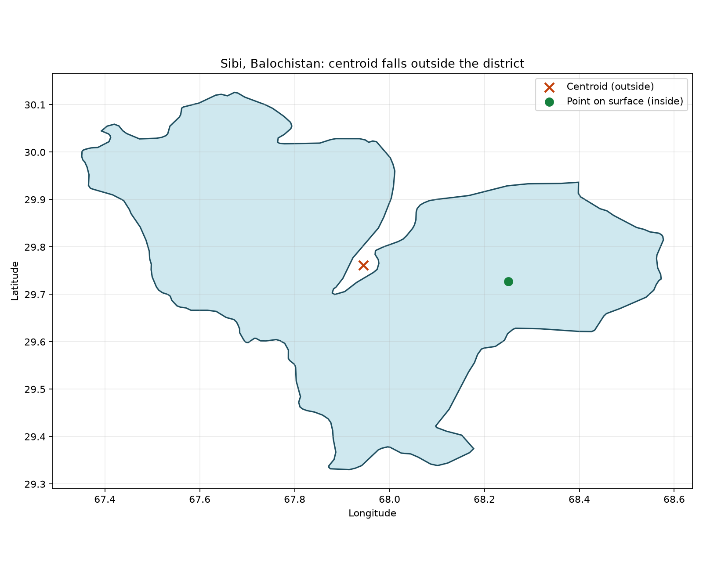

District points were created with Shapely’s `representative_point()` (same idea as QGIS **Point on Surface**): each point lies inside its own polygon. A geometric **centroid** is not always inside an irregular district.

**Sibi, Balochistan** is the district whose centroid falls **outside** the polygon. A point-on-surface location is used for the population symbols instead.

### Exported point layer

<table>
  <thead>
    <tr><th>Item</th><th>Recorded value</th></tr>
  </thead>
  <tbody>
    <tr><td>File</td><td><code>data/district_points.geojson</code></td></tr>
    <tr><td>Number of point features</td><td><strong>160</strong></td></tr>
    <tr><td>Coordinate reference system</td><td><strong>EPSG:4326 (WGS 84)</strong></td></tr>
    <tr><td>Export coordinate precision</td><td><strong>5 decimal places</strong></td></tr>
    <tr><td>File size</td><td><strong>34,274 bytes</strong></td></tr>
  </tbody>
</table>

Point features inherit `district`, `province`, `pcode`, `pop_2023` and `area_km2`. `pop_2023` sizes the proportional circles.

---

## Checkpoint 3: The Page, Map and Basemaps

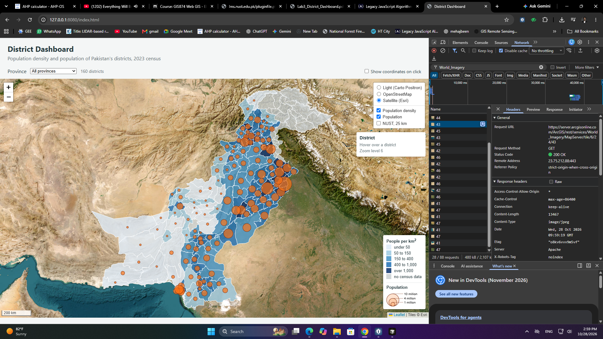

The layer control offers three basemaps. OpenStreetMap is the default because Carto Positron currently watermarks tiles with an API-key notice.

<table>
  <thead>
    <tr><th>Control label</th><th>Source</th><th>Role</th></tr>
  </thead>
  <tbody>
    <tr><td>Light (Carto Positron)</td><td>CARTO <code>light_all</code></td><td>Optional light basemap</td></tr>
    <tr><td>OpenStreetMap</td><td>OSM raster tiles</td><td>Default (readable without an API key)</td></tr>
    <tr><td>Satellite (Esri)</td><td>Esri World Imagery</td><td>Satellite overlay</td></tr>
  </tbody>
</table>

**Observed Esri request URL:**  
`https://server.arcgisonline.com/ArcGIS/rest/services/World_Imagery/MapServer/tile/6/24/43`

<table>
  <thead>
    <tr><th>URL component</th><th>Value</th><th>Meaning</th></tr>
  </thead>
  <tbody>
    <tr><td><code>z</code></td><td>6</td><td>Zoom level</td></tr>
    <tr><td><code>y</code></td><td>24</td><td>Tile <strong>row</strong></td></tr>
    <tr><td><code>x</code></td><td>43</td><td>Tile <strong>column</strong></td></tr>
    <tr><td>HTTP status</td><td>200 OK</td><td>Tile loaded successfully</td></tr>
  </tbody>
</table>

**Answer:** The Esri template is `{z}/{y}/{x}` (zoom, **row**, **column**).

---

## Checkpoint 4: Population Density Choropleth

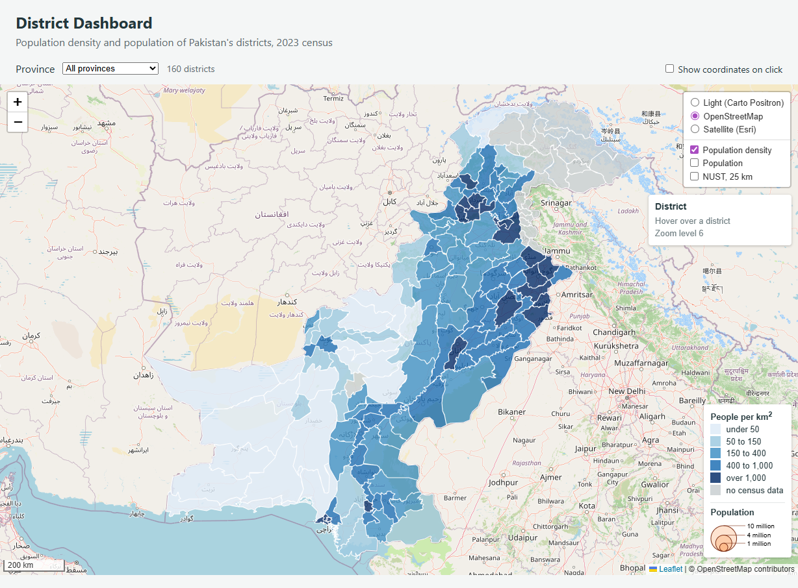

Polygons are shaded by **population density** (`pop_2023 / area_km2`), not by headcount. Density is the right choropleth variable because districts have very different areas.

<table>
  <thead>
    <tr><th>Population density (people/km²)</th><th>Map colour</th><th>Hex</th></tr>
  </thead>
  <tbody>
    <tr><td>50 or below</td><td>Very light blue</td><td><code>#deebf7</code></td></tr>
    <tr><td>Above 50 to 150</td><td>Light blue</td><td><code>#9ecae1</code></td></tr>
    <tr><td>Above 150 to 400</td><td>Medium blue</td><td><code>#4292c6</code></td></tr>
    <tr><td>Above 400 to 1,000</td><td>Dark blue</td><td><code>#2171b5</code></td></tr>
    <tr><td>Above 1,000</td><td>Very dark blue</td><td><code>#08306b</code></td></tr>
    <tr><td>Missing census population</td><td>Grey</td><td><code>#c9cfd1</code></td></tr>
  </tbody>
</table>

The dashboard shows **160 districts**, a density legend, and overlays in the layer control.

---

## Checkpoint 5: Highlighting and an Information Panel

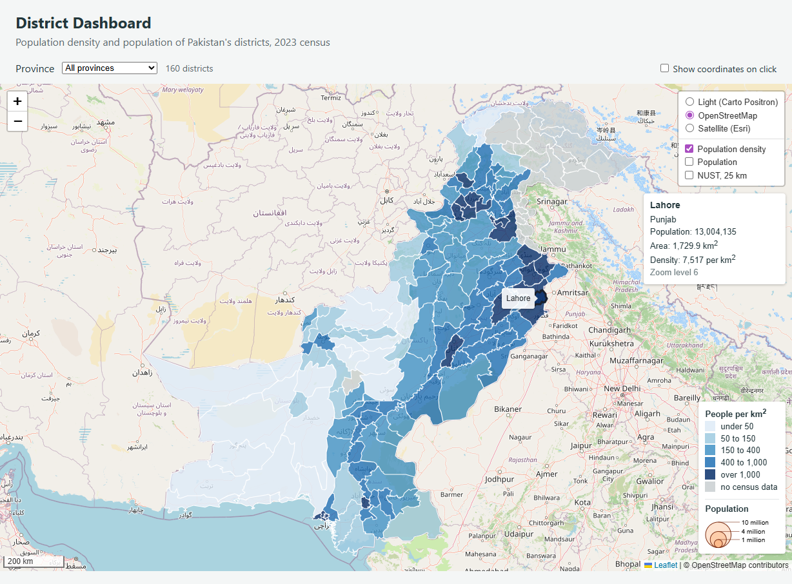

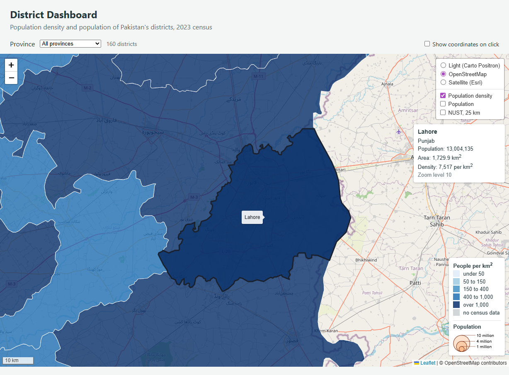

Hovering a district thickens and darkens its outline, shows a tooltip, and fills the information panel (name, province, population, area, density, zoom). `mouseout` calls `resetStyle()`. A click runs `fitBounds()` so the map zooms to that district.

---

## Checkpoint 6: Proportional Symbols in Their Own Pane

### District population circles

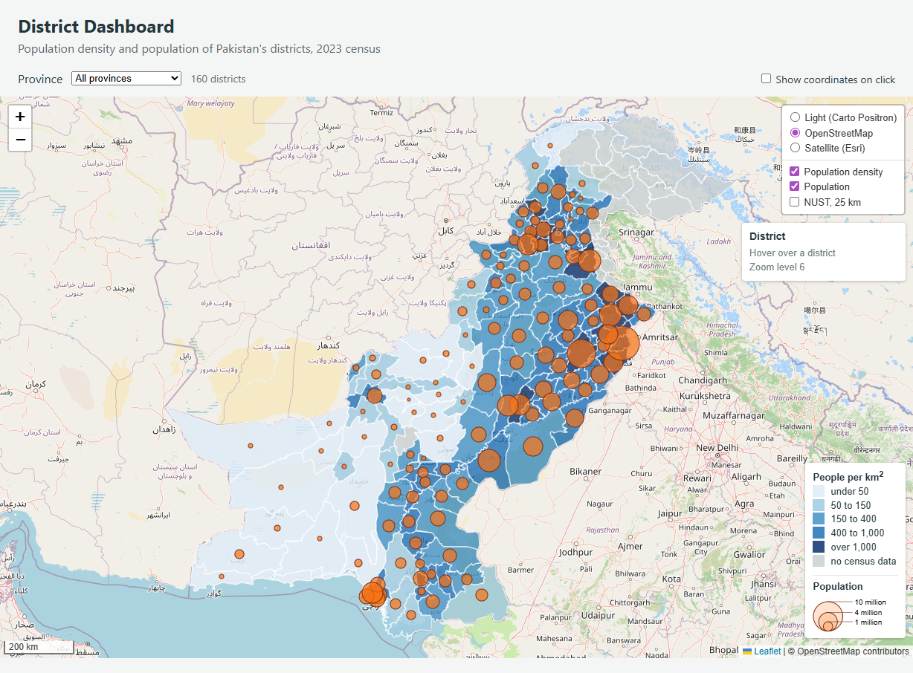

Orange `L.circleMarker` symbols show **population counts** on a pane named `symbols` with `z-index: 450`, above the default overlay pane (`z-index: 400`). Districts with missing `pop_2023` are filtered out of the circle layer.

Radius is `Math.sqrt(population) / 160`, so **area**, not radius, scales with population. The circle legend shows 1 million, 4 million and 10 million people.

### NUST overlay — zoom level 5

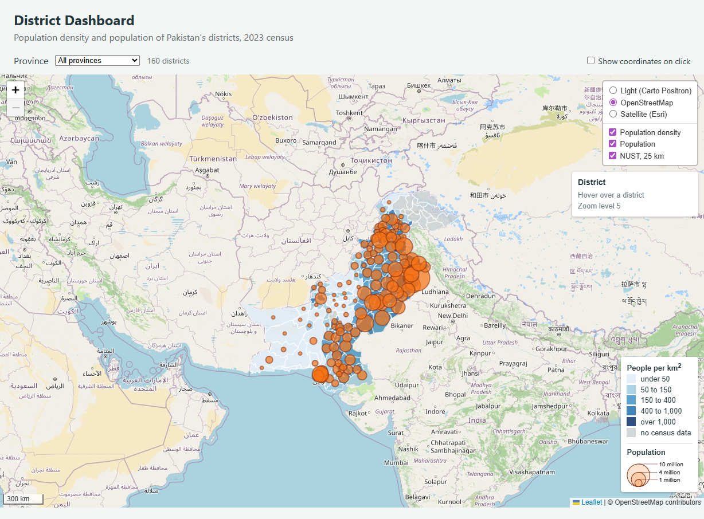

### NUST overlay — zoom level 10

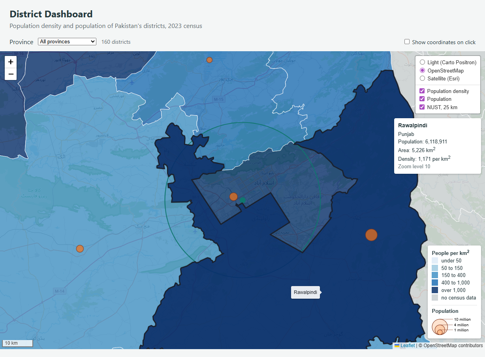

<table>
  <thead>
    <tr><th>Symbol</th><th>Leaflet class</th><th>Radius unit</th><th>What happens when you zoom in</th></tr>
  </thead>
  <tbody>
    <tr><td>25 km zone around NUST H-12</td><td><code>L.circle()</code></td><td>metres</td><td>Grows on screen; stays 25 km on the ground</td></tr>
    <tr><td>Campus marker</td><td><code>L.circleMarker()</code></td><td>pixels (6 px)</td><td>Stays about the same size on screen</td></tr>
  </tbody>
</table>

At zoom **5** the 25 km geographic circle is small at national scale. At zoom **10** it fills much more of the screen. The 25 km circle can be checked against Leaflet’s metric scale bar.

---

## Checkpoint 7: Map Events — On and Off

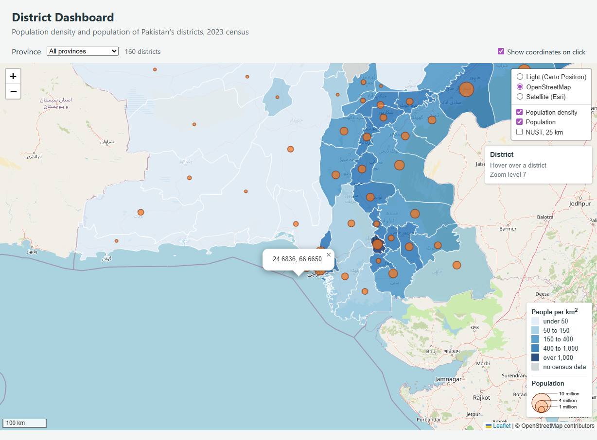

**Show coordinates on click** adds or removes a named `click` handler.

### Part 7.3 — Event experiments

<table>
  <thead>
    <tr><th>#</th><th>Test</th><th>Observed result</th></tr>
  </thead>
  <tbody>
    <tr>
      <td>1</td>
      <td>Click the sea, then a district, with the checkbox on</td>
      <td>Sea click south of Karachi opened <strong>24.6836, 66.6650</strong>. A district click still zooms to that district.</td>
    </tr>
    <tr>
      <td>2</td>
      <td>Click the legend with and without click-propagation protection</td>
      <td><code>L.DomEvent.disableClickPropagation(div)</code> stops legend clicks from reaching the map. Removing it lets a legend click open a coordinate popup. Protection is kept in the submitted code.</td>
    </tr>
    <tr>
      <td>3</td>
      <td>Untick the checkbox and click the sea</td>
      <td><code>map.off('click', showCoordinates)</code> removes the handler, so later sea clicks do not open new coordinate popups.</td>
    </tr>
  </tbody>
</table>

`showCoordinates` is a **named** function, so `map.on` and `map.off` receive the same function reference. The information panel also refreshes its zoom line on `zoomend`.

---

## Checkpoint 8: Filter by Province (Extension)

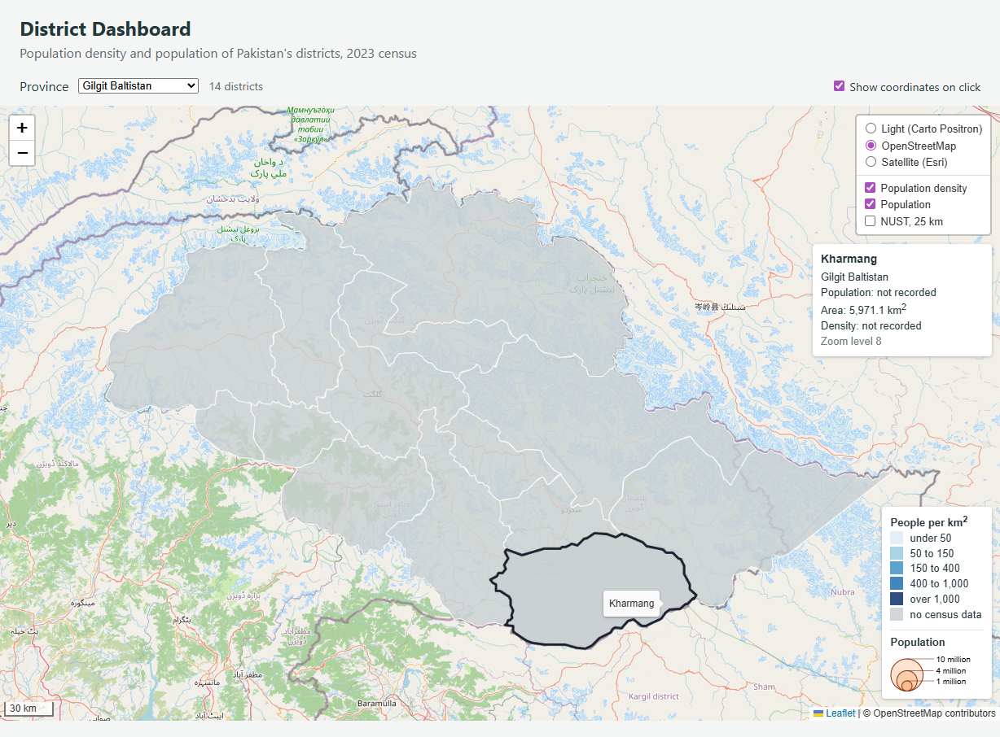

Selecting **Gilgit Baltistan** filters the map to **14 districts**. They are **grey** and have **no orange circles** because `pop_2023` is missing. That means the census values are **unavailable**, not that population is zero.

<table>
  <thead>
    <tr><th>Check</th><th>Observed result</th></tr>
  </thead>
  <tbody>
    <tr><td>Province</td><td>Gilgit Baltistan</td></tr>
    <tr><td>Displayed district count</td><td>14</td></tr>
    <tr><td>District density colour</td><td>Grey (missing census data)</td></tr>
    <tr><td>Population circles</td><td>None</td></tr>
    <tr><td>Overlay control</td><td>Density and population still listed and enabled</td></tr>
  </tbody>
</table>

The layer control points at permanent `districtGroup` and `circleGroup` objects, so overlays still toggle after a filtered redraw.

---

## Checkpoint 9: SVG Versus Canvas (Extension)

Canvas mode is [https://megaorbits.github.io/webgis-lab3/index.html?canvas](https://megaorbits.github.io/webgis-lab3/index.html?canvas) (`preferCanvas: true`). Default mode is SVG.

### SVG mode — Elements panel

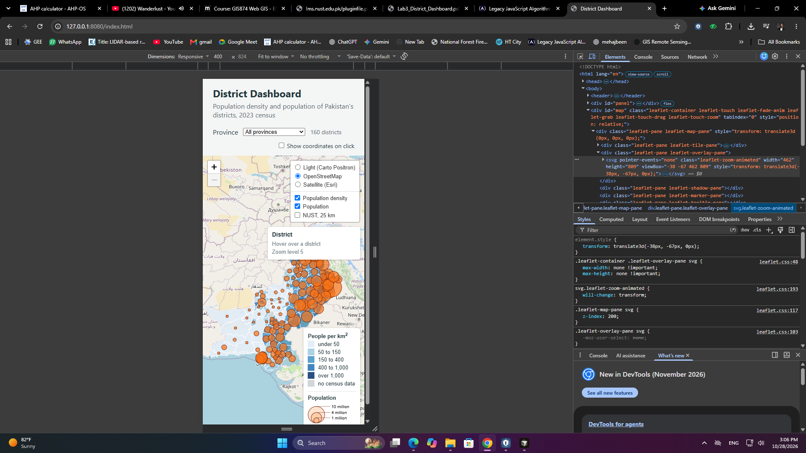

`leaflet-overlay-pane` contains **one `<svg>`**. Expanding it shows **160 `<path>`** elements (one per district).

### Canvas mode — Elements panel

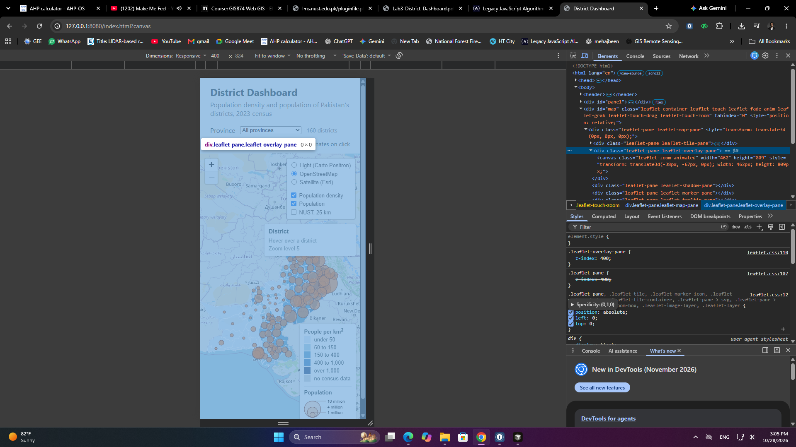

With `?canvas`, the same pane contains **one `<canvas class="leaflet-zoom-animated">`** and **no** district `<path>` nodes.

Five `draw('all')` timings were recorded in the Console (`performance.now()` inside `draw`).

<table>
  <thead>
    <tr><th>Run</th><th>SVG (ms)</th><th>Canvas (ms)</th></tr>
  </thead>
  <tbody>
    <tr><td>1</td><td>50.8</td><td>59.6</td></tr>
    <tr><td>2</td><td>39.0</td><td>32.8</td></tr>
    <tr><td>3</td><td>33.7</td><td>34.3</td></tr>
    <tr><td>4</td><td>41.2</td><td>28.1</td></tr>
    <tr><td>5</td><td>34.3</td><td>28.1</td></tr>
  </tbody>
</table>

<table>
  <thead>
    <tr><th></th><th>SVG sorted (ms)</th><th>Canvas sorted (ms)</th></tr>
  </thead>
  <tbody>
    <tr><td></td><td>33.7, 34.3, <strong>39.0</strong>, 41.2, 50.8</td><td>28.1, 28.1, <strong>32.8</strong>, 34.3, 59.6</td></tr>
  </tbody>
</table>

### Renderer comparison

<table>
  <thead>
    <tr><th>Measurement</th><th>SVG</th><th>Canvas</th></tr>
  </thead>
  <tbody>
    <tr><td><code>draw(all)</code>, median of five</td><td><strong>39.0 ms</strong></td><td><strong>32.8 ms</strong></td></tr>
    <tr><td>Elements inside <code>leaflet-overlay-pane</code></td><td><strong>1 SVG, 160 paths</strong></td><td><strong>1 canvas element</strong></td></tr>
    <tr><td>Hover highlighting still works?</td><td><strong>Yes</strong></td><td><strong>Yes</strong></td></tr>
    <tr><td>Can one district be inspected in Elements?</td><td><strong>Yes</strong>, as its own SVG path</td><td><strong>No</strong>, districts are pixels on one canvas</td></tr>
  </tbody>
</table>

### Interpretation

Canvas was **6.2 ms faster** than SVG by the median of five runs. For 160 districts the gap is small.

SVG keeps each district as a DOM `path`. Canvas paints all geometries onto one drawing surface. Leaflet hover still works in both modes because hit-testing is geographic, not only DOM-based. Canvas does not expose a separate element per district in Elements.

For a larger **tehsil (ADM3)** dataset, Canvas should scale better by avoiding thousands of DOM nodes. That should still be timed on the target browser.

---

## Section 10.3: Final Questions

### Question 1

**Lab 2 shaded districts by population. Name one large, thinly populated district and one small, crowded one, and explain how each would mislead on the Lab 2 map.**

<table>
  <thead>
    <tr><th>District</th><th>Population (2023)</th><th>Area (km²)</th><th>Density (people/km²)</th></tr>
  </thead>
  <tbody>
    <tr><td><strong>Chagai, Balochistan</strong> (large, thin)</td><td>269,192</td><td>44,476.9</td><td>~6</td></tr>
    <tr><td><strong>Lahore, Punjab</strong> (small, crowded)</td><td>13,004,135</td><td>1,729.9</td><td>~7,517</td></tr>
  </tbody>
</table>

**Answer:** On a count choropleth, Chagai’s huge area looks “important” even though few people live there, while Lahore is a small dark patch despite holding millions. Density (people per km²) compares districts of different sizes more fairly.

### Question 2

**radiusFor takes a square root. What would the map suggest about Lahore against a district of 3 million if it did not?**

**Answer:** Lahore (~13.0 million) is about **4.3 times** a 3-million-person district. If **radius** scaled with population, circle **area** would scale with the square of that ratio, about **18.8 times** as large, which overstates Lahore. The square root makes **area** roughly proportional to population.

### Question 3

**Why does the layer control hold districtGroup rather than the L.geoJSON layer itself?**

**Answer:** `districtGroup` is a stable `L.featureGroup`. Province filtering **clears** that group and adds a **new** `L.geoJSON` layer. The layer control still toggles the group, so it always shows the current polygons. If it referenced the first GeoJSON object, that object would be leftover after a filter.

### Question 4

**What would go wrong if the circles were drawn in overlayPane instead of the symbols pane? Describe what the user would see when hovering.**

**Answer:** Hover calls `bringToFront()` on the district polygon. In the same pane, that polygon can jump **above** the orange circles and hide them. A `symbols` pane at z-index **450** keeps circles above highlighted polygons.

### Question 5

**Why can map.off remove showCoordinates, when it could not remove an anonymous function passed to map.on?**

**Answer:** `showCoordinates` is one named function, so `map.on` and `map.off` get the **same reference**. An anonymous function written inline in `map.on` is a different object; `map.off` cannot match it unless that same function object was stored.

### Question 6

**On the NUST overlay, which circle would you use to show a 25 km evacuation zone, and which to mark the campus on a national map? Why?**

**Answer:** Use **`L.circle()`** for a 25 km evacuation zone: radius is in **metres** and stays 25 km on the ground at every zoom. Use **`L.circleMarker()`** to mark the campus on a national map: radius is in **pixels**, so the marker stays a readable size when zoomed out.
